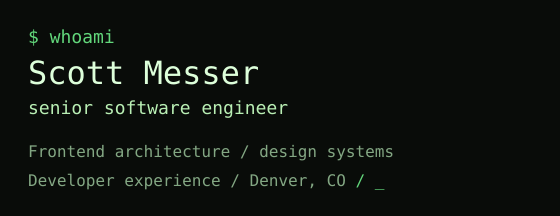

<samp><a href="https://www.scottmesser.dev">[ portfolio ]</a> <a href="https://www.scottmesser.dev/#resume">[ resume ]</a> <a href="mailto:scott@breadfactorystudios.com">[ email Scott ]</a></samp>

### `$ cat resume`

I build customer-facing products and the shared frontend foundations behind them: components, theming, build infrastructure, and developer workflows. React and TypeScript are at the center of my work.

Senior Software Engineer at **Signal Advisors** and Co-Founder of **Bread Factory Studios**. Based in Denver, Colorado.

- **[Frontend & design systems resume / PDF](https://www.scottmesser.dev/files/Scott-Messer-Resume-Frontend-Design-Systems.pdf)** — shared UI, theming, accessibility, and product engineering.
- **[Frontend platform & developer experience resume / PDF](https://www.scottmesser.dev/files/Scott-Messer-Resume-Frontend-Platform-DevEx.pdf)** — monorepos, CI, preview environments, and engineering workflows.

### `$ git activity`

Most of my engineering work lives in private repositories. This graph includes the anonymized contribution counts shared on my public profile; the case studies below explain the work behind them.

### `$ ls selected-work`

**[Faster builds through monorepo modernization](https://www.scottmesser.dev/#monorepo-ci)**  
Proposed, planned, and implemented an NX-to-Turborepo migration and CI improvements across a **27-person engineering organization**. Measured CI build time fell from **20 minutes to 5 minutes — a 75% reduction**.

**[One platform, a distinct identity for every firm](https://www.scottmesser.dev/#firm-theming)**  
Designed and implemented generally available firm branding at Signal Advisors. Website branding extraction, editable color suggestions, semantic tokens, and a theme constructor bring each firm's identity across the portal.

**[A component foundation for agent-assisted development](https://www.scottmesser.dev/#agent-ready-ui)**  
Rebuilt a legacy UI package with Base UI and Tailwind CSS, organized reusable components, and removed older component code. Storybook-to-Figma integration is in progress.

### `$ cat experience`

**Signal Advisors / Senior Software Engineer**  
Apr 2020–present. Early engineering hire, employee #18. Built shared frontend components and standards, introduced Vercel preview workflows, and led frontend GraphQL adoption. The platform supports **$2B+ in AUM** and **$1B+ in annual annuity production**.

**Bread Factory Studios / Co-Founder & Software Consultant**  
Jan 2020–present. Architecture and delivery for custom web and mobile applications, including automotive lead-generation and analytics tools used at national auto shows.

Earlier experience & education

- **Nerdy Bunny / Senior Software Engineer** · Oct 2019–Mar 2020. Digital signage and interactive retail content.
- **Bluewater Technologies / Mobile Developer** · May 2018–Oct 2019. Mobile lead generation for GM events and auto shows.
- **Ford Motor Company / iOS Developer** · Aug 2016–May 2018. Enterprise vehicle information and diagnostic applications.
- **Oakland University** · Bachelor of Science, Information Systems.

### `$ cat stack`

| Area | Tools & practice |
| :--- | :--- |
| **Product UI** | `React` `TypeScript` `Next.js` · complex forms, data visualization |
| **Design systems** | `Storybook` `Base UI` `Tailwind CSS` · semantic tokens, accessibility |
| **Developer experience** | `Turborepo` `NX` `Vercel` `CI/CD` · monorepos, previews, build infrastructure |
| **APIs & data** | `GraphQL` `NestJS` `Node.js` `PostgreSQL` |
| **Mobile & AI tooling** | `SwiftUI` `UIKit` `React Native` · practical AI-assisted engineering |

### `$ contact`

[scott@breadfactorystudios.com](mailto:scott@breadfactorystudios.com) · [scottmesser.dev](https://www.scottmesser.dev) · [Bread Factory Studios](https://breadfactorystudios.com)

Read this resume through MCP

Connect an MCP client to `https://www.scottmesser.dev/mcp` and call `get_resume` for the public resume, case studies, and document links. Streamable HTTP; no API key required.

