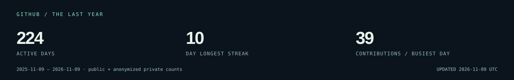

<a href="https://www.scottmesser.dev">EXPLORE MY WORK</a> &nbsp; / &nbsp; <a href="https://www.scottmesser.dev/#resume">RESUME + PDFS</a> &nbsp; / &nbsp; <a href="mailto:scott@breadfactorystudios.com">SAY HELLO</a>

I build the frontend foundations that help people do their best work—and occasionally, keep a penguin out of trouble.

**Senior Software Engineer at Signal Advisors** · **Co-Founder, Bread Factory Studios**

### Thoughtful systems. Real impact.

| From the field | Inside the work |
| :--- | :--- |
| **75% faster measured CI builds** · 20 minutes → 5 | [NX → Turborepo migration across a 27-person engineering organization](https://www.scottmesser.dev/#monorepo-ci) |
| **One platform. Every firm’s own identity.** | [Brand extraction, semantic tokens, shared components, and portal-wide theming](https://www.scottmesser.dev/#firm-theming) |
| **A shared language for building UI** | [Base UI + Tailwind component foundation for agent-assisted development](https://www.scottmesser.dev/#agent-ready-ui) · work in progress |

React · TypeScript · Design systems · Accessibility · Frontend architecture · Developer experience

### A little side quest

**[Play Save the Penguin →](https://www.scottmesser.dev/play/index.html)** — My 2015 Swift/SpriteKit game, rebuilt for the browser with original arctic art, gravity-driven balancing, two difficulty modes, keyboard and touch controls, and local best scores. Click the scene to enter the arcade.

### Field notes

### The professional part

[Frontend & Design Systems resume](https://www.scottmesser.dev/files/Scott-Messer-Resume-Frontend-Design-Systems.pdf) · [Frontend Platform & DevEx resume](https://www.scottmesser.dev/files/Scott-Messer-Resume-Frontend-Platform-DevEx.pdf)

Previously: Nerdy Bunny · Bluewater Technologies · Ford Motor Company. BS, Information Systems — Oakland University.

For curious humans and their agents: my [public resume MCP endpoint](https://www.scottmesser.dev/mcp) exposes resume content, case studies, and document links through `get_resume`.

Built with care. And a small penguin.

